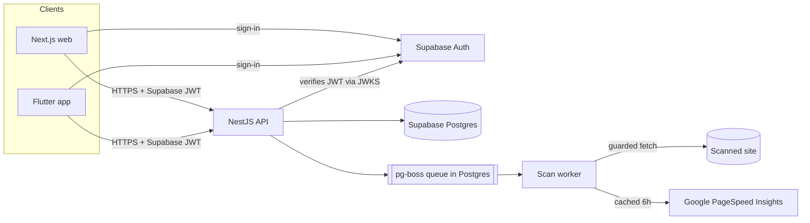

# Weblume

Website audits your clients can actually read. Users enter a URL; Weblume checks performance, SEO, accessibility and technical health, and explains each finding in plain language with concrete fixes.

> **Status:** Phase 4 (Android app) of 6 complete. See [`docs/PROGRESS.md`](docs/PROGRESS.md) for what works today and what's next, and [`docs/BUILD_PROMPT.md`](docs/BUILD_PROMPT.md) for the full product spec.

## Repository layout

```
apps/
  web/              Next.js 16 (App Router, React 19, Tailwind 4) — marketing site + scan/report pages
  api/              NestJS 12 — REST API + scan worker (pg-boss)
    src/scanner/    Guarded HTTP client (SSRF defences), checks, PSI integration, scan runner
  mobile/           Flutter 3.47 — Android-first app (Riverpod 3, go_router)
packages/
  design-tokens/    tokens.json → CSS variables (web) + Dart constants (mobile)
  shared/           Plan config, URL normalisation, check catalogue (finding copy), report types
  api-client-ts/    Typed API client generated from apps/api/openapi.json
supabase/
  migrations/       SQL migrations (source of truth for the schema)
  tests/            RLS tests + auth stub for verifying on plain Postgres
docs/               Progress, decisions, runbooks, spec
scripts/            Repo tooling (DB verification, generated-file checks)
```

## Architecture



- **Auth:** Supabase Auth issues JWTs; the API verifies them (asymmetric keys via JWKS, or the legacy HS256 secret) on every request. Every route requires auth unless marked `@Public()`.
- **Authorisation:** done in the API. Row Level Security is enabled on every table as a second layer.
- **API contract:** NestJS generates `apps/api/openapi.json`; the TypeScript client (openapi-typescript) and the Dart client (`scripts/generate-dart-client.mjs`) are generated from it. CI fails if generated files are stale.
- **Scanning:** `POST /v1/scans` validates and normalises the URL, enforces quota, then queues a job. The worker fetches the page through the guarded client (DNS pinning, public-IP allow-list, per-hop redirect checks, size/time limits), runs the HTML/robots/sitemap/link checks, and calls PSI (mobile + desktop) in parallel. Reports never contain invented data. See [`docs/scoring.md`](docs/scoring.md).
- **Guests:** one scan per day per IP (stored as an HMAC, never the raw IP), protected by Cloudflare Turnstile. Guests get a one-time scan token to view their report.
- **Design tokens:** one `packages/design-tokens/tokens.json` drives web CSS variables and Flutter theme constants. Colour pairs are tested for WCAG AA contrast.

## Prerequisites

| Tool                       | Version                  | Notes                                        |
| -------------------------- | ------------------------ | -------------------------------------------- |
| Node.js                    | 22+ (`.nvmrc`)           |                                              |
| pnpm                       | 10.28+                   | `corepack enable`                            |
| Flutter                    | 3.47+ stable (Dart 3.13) | Mobile only                                  |
| Android SDK + JDK 17       |                          | To build the APK                             |
| Supabase CLI + Docker      | latest                   | For a full local Supabase (`supabase start`) |
| PostgreSQL client (`psql`) | 16+                      | For `pnpm db:verify`                         |

## Quick start

```bash
corepack enable
pnpm install
pnpm --filter "./packages/*" run build   # shared packages must be built before the apps
```

**Database and auth (local Supabase):**

```bash
supabase start          # prints the API URL, keys and DB URL
supabase db reset       # applies supabase/migrations and seed.sql
```

**API:**

```bash
cp apps/api/.env.example apps/api/.env   # adjust DATABASE_URL / SUPABASE_URL from `supabase start`
pnpm dev:api                             # http://localhost:4000, Swagger UI at /docs (non-production)
```

**Web:**

```bash
cp apps/web/.env.example apps/web/.env.local
pnpm dev:web                             # http://localhost:3000
```

**Mobile:** see [`apps/mobile/README.md`](apps/mobile/README.md).

## Environment variables

Never commit real values. Each app has a `.env.example`.

### `apps/api`

| Variable                                                           | Required          | Default                       | Description                                                                                         |
| ------------------------------------------------------------------ | ----------------- | ----------------------------- | --------------------------------------------------------------------------------------------------- |
| `NODE_ENV`                                                         | no                | `development`                 | `development` / `test` / `production`                                                               |
| `PORT`                                                             | no                | `4000`                        | HTTP port                                                                                           |
| `CORS_ORIGINS`                                                     | no                | (none)                        | Comma-separated allowed browser origins                                                             |
| `LOG_LEVEL`                                                        | no                | `info`                        | pino log level                                                                                      |
| `DATABASE_URL`                                                     | **yes**           | —                             | Postgres connection string (use the Supabase pooler in production)                                  |
| `SUPABASE_URL`                                                     | **yes**           | —                             | Supabase project URL; used for JWKS and issuer checks                                               |
| `SUPABASE_JWT_SECRET`                                              | no                | —                             | Only for projects still on the legacy HS256 secret                                                  |
| `RATE_LIMIT_PER_MINUTE`                                            | no                | `60`                          | Per-IP request limit                                                                                |
| `TRUST_PROXY_HOPS`                                                 | no                | `0`                           | Reverse proxies in front of the API (for correct client IPs)                                        |
| `PSI_API_KEY`                                                      | no                | —                             | Google PageSpeed Insights key. Without it reports say Lighthouse data is unavailable                |
| `PSI_CACHE_TTL_HOURS`                                              | no                | `6`                           | How long PSI results are reused per URL + strategy                                                  |
| `PUBLIC_SITE_URL`                                                  | no                | `http://localhost:3000`       | Used in the bot User-Agent (`WeblumeBot/1.0 (+<url>/bot)`)                                          |
| `SCAN_TIMEOUT_MS` / `SCAN_PAGE_TIMEOUT_MS` / `SCAN_PAGE_MAX_BYTES` | no                | `90000` / `10000` / `5000000` | Scan limits                                                                                         |
| `SCAN_GLOBAL_CONCURRENCY`                                          | no                | `3`                           | Scans run at once per worker                                                                        |
| `SCAN_BLOCKED_HOSTS`                                               | no                | —                             | Extra hostnames the scanner must never fetch                                                        |
| `SCAN_CREATE_RATE_LIMIT_PER_MINUTE`                                | no                | `10`                          | Per-IP limit for starting/retrying scans                                                            |
| `WORKER_ENABLED`                                                   | no                | `true`                        | Run the scan worker in this process                                                                 |
| `GUEST_HASH_SECRET`                                                | **prod**          | random per process            | ≥ 32 chars; HMAC key for guest IP hashes                                                            |
| `SUPABASE_SECRET_KEY`                                              | no                | —                             | Server-only. Lets account deletion remove the Supabase Auth user; without it deletions stay pending |
| `TURNSTILE_SECRET_KEY`                                             | **prod (guests)** | —                             | Without it, guest scans are refused in production (allowed unverified in development)               |

### `apps/web`

| Variable                                                            | Description                                                                            |
| ------------------------------------------------------------------- | -------------------------------------------------------------------------------------- |
| `NEXT_PUBLIC_SITE_URL`                                              | Public site URL, for canonical URLs, sitemap and Open Graph                            |
| `NEXT_PUBLIC_API_URL`                                               | Weblume API base URL                                                                   |
| `NEXT_PUBLIC_SUPPORT_EMAIL`                                         | Support address shown on contact/legal pages                                           |
| `NEXT_PUBLIC_SUPABASE_URL` / `NEXT_PUBLIC_SUPABASE_PUBLISHABLE_KEY` | Supabase project URL and publishable (anon) key. Empty = no accounts, guest scans only |
| `NEXT_PUBLIC_AUTH_GOOGLE_ENABLED`                                   | `true` to show “Continue with Google”                                                  |
| `NEXT_PUBLIC_TURNSTILE_SITE_KEY`                                    | Turnstile site key for guest scans (empty in local dev)                                |

### `apps/mobile` (`--dart-define`)

| Key                                         | Description                                                                                 |
| ------------------------------------------- | ------------------------------------------------------------------------------------------- |
| `API_BASE_URL`                              | Weblume API base URL (default `http://10.0.2.2:4000`, the emulator's host)                  |
| `SITE_URL`                                  | Website URL for legal links                                                                 |
| `SUPABASE_URL` / `SUPABASE_PUBLISHABLE_KEY` | Supabase project for sign-in (also add `weblume://auth-callback` to Supabase redirect URLs) |
| `APP_VERSION`                               | Shown in Account                                                                            |

## Commands

| Command                                      | What it does                                                                                |
| -------------------------------------------- | ------------------------------------------------------------------------------------------- |
| `pnpm lint` / `pnpm typecheck` / `pnpm test` | Run across all TypeScript packages                                                          |
| `pnpm build`                                 | Build packages, then apps                                                                   |
| `pnpm format` / `pnpm format:check`          | Prettier                                                                                    |
| `pnpm tokens`                                | Regenerate design-token outputs (CSS, TS, Dart)                                             |
| `pnpm openapi`                               | Regenerate `openapi.json`, the TypeScript client and the Dart client                        |
| `pnpm openapi:check`                         | Fail if any generated file is stale (used in CI)                                            |
| `pnpm db:test-setup`                         | (Re)create the `weblume_test` database used by the API's database e2e tests                 |
| `pnpm db:verify`                             | Apply migrations to a throwaway DB on plain Postgres and run RLS tests (`DB_ADMIN_URL` env) |
| `pnpm --filter @weblume/web build:e2e`       | Production build pointing at a mocked Supabase URL; run before `test:e2e`                   |
| `pnpm --filter @weblume/web test:e2e`        | Playwright + axe tests against the build (run `build:e2e` first)                            |
| `pnpm mobile:analyze` / `pnpm mobile:test`   | Flutter analyze / widget tests                                                              |

## Testing

- **Scanning:** `POST /v1/scans` validates and normalises the URL, enforces quota, then queues a job. The worker fetches the page through the guarded client (DNS pinning, public-IP allow-list, per-hop redirect checks, size/time limits), runs the HTML/robots/sitemap/link checks, and calls PSI (mobile + desktop) in parallel. Reports never contain invented data. See [`docs/scoring.md`](docs/scoring.md).
- **Guests:** one scan per day per IP (stored as an HMAC, never the raw IP), protected by Cloudflare Turnstile. Guests get a one-time scan token to view their report.
- **Design tokens:** WCAG AA contrast for every text/background pair and severity badge, light and dark.
- **Scanner security:** 90+ tests for the guarded client: every blocked IP range (loopback, private, CGNAT, link-local/metadata, IPv6 ULA/link-local, IPv4-mapped, NAT64/6to4/Teredo, documentation…), alternative IP notations, blocked schemes/ports/credentials, hostnames resolving privately, mixed DNS answers, redirects to private targets, redirect loops, oversized and slow-drip bodies, timeouts.
- **Checks:** HTML checks against fixtures; robots/sitemap/link checks against a local server; PSI mapping against a hand-built PSI v5 fixture.
- **Scans API (database e2e):** requires `TEST_DATABASE_URL` (run `pnpm db:test-setup` first): full lifecycle, dedupe, concurrency, authorisation, guest tokens, Turnstile, quotas, failures and free retries, PSI partial/not-configured/kill switch/cache.
- **API:** in-process e2e tests (Vitest + Supertest) for health/readiness, JWT verification (ES256 via JWKS, HS256, expired/wrong issuer/audience/role/unknown key/`alg=none`), rate limiting, security headers, env validation.
- **Database:** `pnpm db:verify` applies the migrations and asserts RLS isolation between users, no direct user writes, and cascade deletes.
- **Accounts (database e2e):** `/v1/me`, profile updates, entitlements from subscription states (billing on/off, every status), billing-period quotas, claiming guest scans, export, deletion (immediate, deferred, failing admin call), retention job.
- **Web auth flows:** Playwright with Supabase Auth and the API mocked: sign-up, log-in errors, dashboard, guarded routes and safe `?next=` redirects, guest-scan claiming, password reset via PKCE code, callback errors, account settings (name, export, deletion), log-out.
- **Web scan flow:** Playwright with the API mocked at the network layer: validation, progress polling, report rendering and filters, partial/failed/not-found/offline states, retry, history.
- **Web:** Playwright on desktop and mobile viewports: every page renders, SEO metadata is present, there are no axe WCAG 2.2 AA violations (light and dark), navigation and the mobile menu work, there's no horizontal scroll, and security headers are set.
- **Mobile:** 69 tests: generated client and offline repository, URL validation against the shared cases, router redirects, auth flows, scan flow through to finding detail, failure/partial/offline states, history, account deletion, and accessibility guidelines (tap targets, labels, contrast) in light and dark.

## Supabase Auth setup (manual)

1. Create a Supabase project. Copy the **Project URL** and **publishable key** to the web env, the URL to `SUPABASE_URL` in the API, and the **secret key** to `SUPABASE_SECRET_KEY` (API only, never the web).
2. Authentication → URL configuration: set **Site URL** to your site, and add redirect URLs `https://<site>/auth/callback` and `https://<site>/auth/reset-password`.
3. Authentication → Providers → Email: keep **Confirm email** on. Set password requirements to at least 10 characters with lower, upper and digits (matches the web form and `supabase/config.toml`).
4. Authentication → Emails → SMTP: configure a real SMTP provider (Resend/Postmark free tiers). The built-in sender is rate-limited and only for testing.
5. Optional: Authentication → Providers → Google (OAuth client from Google Cloud), then set `NEXT_PUBLIC_AUTH_GOOGLE_ENABLED=true`.
6. Apply migrations: `supabase link` then `supabase db push`.

See also [`docs/privacy-data-map.md`](docs/privacy-data-map.md).

## Deployment (not deployed yet)

Nothing is deployed and no paid resources have been created. The planned low-cost setup:

- **Database + auth:** Supabase. The free tier pauses inactive projects; use a paid plan for production.
- **API (+ worker):** one small container on Fly.io, Render or Railway. Set `TRUST_PROXY_HOPS=1` and `NODE_ENV=production`.
- **Web:** Cloudflare Pages or Vercel Pro (Vercel Hobby forbids commercial use).

Migrations are applied with `supabase db push` against the linked project. Backups: [`docs/runbooks/backup-restore.md`](docs/runbooks/backup-restore.md).

## Troubleshooting

- **Web build can't resolve `@weblume/design-tokens/tokens.css`:** build the packages first (`pnpm --filter "./packages/*" run build`).
- **`pnpm install` warns about ignored build scripts for `@scarf/scarf`:** expected. That's a telemetry postinstall from swagger-ui, which we deliberately don't run.
- **API `/ready` returns 503:** the database isn't reachable; check `DATABASE_URL`. `/health` stays 200 because it doesn't touch dependencies.
- **Scans fail with `dns_failure`/`connection_failed` locally:** the worker needs direct outbound internet access (it deliberately doesn't use HTTP proxies, which would bypass DNS pinning).
- **Guest scans return `guest_scans_disabled` in production:** set `TURNSTILE_SECRET_KEY` (and `NEXT_PUBLIC_TURNSTILE_SITE_KEY` on the web).
- **401 on every request:** make sure `SUPABASE_URL` matches the project that issued the token (the issuer must be `<SUPABASE_URL>/auth/v1`).
