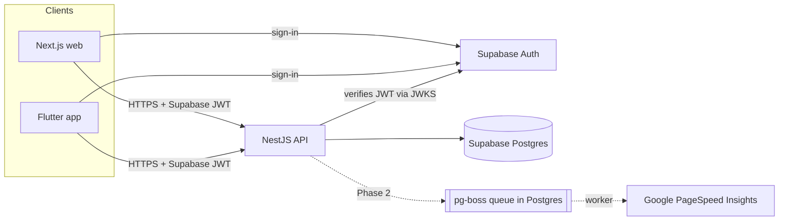

# Weblume

Website audits your clients can actually read. Users enter a URL; Weblume checks performance, SEO, accessibility and technical health, and explains each finding in plain language with concrete fixes.

> **Status:** Phase 1 (foundation) of 6. See [`docs/PROGRESS.md`](docs/PROGRESS.md) for what works today and what's next, and [`docs/BUILD_PROMPT.md`](docs/BUILD_PROMPT.md) for the full product spec.

## Repository layout

```
apps/
  web/              Next.js 16 (App Router, React 19, Tailwind 4) — marketing site; web app from Phase 2
  api/              NestJS 12 — REST API (+ scan worker from Phase 2)
  mobile/           Flutter 3.47 — Android-first app (Riverpod 3, go_router)
packages/
  design-tokens/    tokens.json → CSS variables (web) + Dart constants (mobile)
  shared/           Plan/entitlement config, severities, scan states (TypeScript)
  api-client-ts/    Typed API client generated from apps/api/openapi.json
supabase/
  migrations/       SQL migrations (source of truth for the schema)
  tests/            RLS tests + auth stub for verifying on plain Postgres
docs/               Progress, decisions, runbooks, spec
scripts/            Repo tooling (DB verification, generated-file checks)
```

## Architecture



- **Auth:** Supabase Auth issues JWTs; the API verifies them (asymmetric keys via JWKS, or the legacy HS256 secret) on every request. Every route requires auth unless marked `@Public()`.
- **Authorisation:** done in the API. Row Level Security is enabled on every table as a second layer.
- **API contract:** NestJS generates `apps/api/openapi.json`; the TypeScript client (and, from Phase 4, the Dart client) are generated from it. CI fails if generated files are stale.
- **Design tokens:** one `packages/design-tokens/tokens.json` drives web CSS variables and Flutter theme constants. Colour pairs are tested for WCAG AA contrast.

## Prerequisites

| Tool                       | Version                  | Notes                                        |
| -------------------------- | ------------------------ | -------------------------------------------- |
| Node.js                    | 22+ (`.nvmrc`)           |                                              |
| pnpm                       | 10.28+                   | `corepack enable`                            |
| Flutter                    | 3.47+ stable (Dart 3.13) | Mobile only                                  |
| Android SDK + JDK 17       |                          | To build the APK                             |
| Supabase CLI + Docker      | latest                   | For a full local Supabase (`supabase start`) |
| PostgreSQL client (`psql`) | 16+                      | For `pnpm db:verify`                         |

## Quick start

```bash
corepack enable
pnpm install
pnpm --filter "./packages/*" run build   # shared packages must be built before the apps
```

**Database and auth (local Supabase):**

```bash
supabase start          # prints the API URL, keys and DB URL
supabase db reset       # applies supabase/migrations and seed.sql
```

**API:**

```bash
cp apps/api/.env.example apps/api/.env   # adjust DATABASE_URL / SUPABASE_URL from `supabase start`
pnpm dev:api                             # http://localhost:4000, Swagger UI at /docs (non-production)
```

**Web:**

```bash
cp apps/web/.env.example apps/web/.env.local
pnpm dev:web                             # http://localhost:3000
```

**Mobile:** see [`apps/mobile/README.md`](apps/mobile/README.md).

## Environment variables

Never commit real values. Each app has a `.env.example`.

### `apps/api`

| Variable                | Required | Default       | Description                                                        |
| ----------------------- | -------- | ------------- | ------------------------------------------------------------------ |
| `NODE_ENV`              | no       | `development` | `development` / `test` / `production`                              |
| `PORT`                  | no       | `4000`        | HTTP port                                                          |
| `CORS_ORIGINS`          | no       | (none)        | Comma-separated allowed browser origins                            |
| `LOG_LEVEL`             | no       | `info`        | pino log level                                                     |
| `DATABASE_URL`          | **yes**  | —             | Postgres connection string (use the Supabase pooler in production) |
| `SUPABASE_URL`          | **yes**  | —             | Supabase project URL; used for JWKS and issuer checks              |
| `SUPABASE_JWT_SECRET`   | no       | —             | Only for projects still on the legacy HS256 secret                 |
| `RATE_LIMIT_PER_MINUTE` | no       | `60`          | Per-IP request limit                                               |
| `TRUST_PROXY_HOPS`      | no       | `0`           | Reverse proxies in front of the API (for correct client IPs)       |

### `apps/web`

| Variable                    | Description                                                 |
| --------------------------- | ----------------------------------------------------------- |
| `NEXT_PUBLIC_SITE_URL`      | Public site URL, for canonical URLs, sitemap and Open Graph |
| `NEXT_PUBLIC_API_URL`       | Weblume API base URL                                        |
| `NEXT_PUBLIC_SUPPORT_EMAIL` | Support address shown on contact/legal pages                |

### `apps/mobile` (`--dart-define`)

| Key            | Description                                                                |
| -------------- | -------------------------------------------------------------------------- |
| `API_BASE_URL` | Weblume API base URL (default `http://10.0.2.2:4000`, the emulator's host) |
| `SITE_URL`     | Website URL for legal links                                                |
| `APP_VERSION`  | Shown in Account                                                           |

## Commands

| Command                                      | What it does                                                                                |
| -------------------------------------------- | ------------------------------------------------------------------------------------------- |
| `pnpm lint` / `pnpm typecheck` / `pnpm test` | Run across all TypeScript packages                                                          |
| `pnpm build`                                 | Build packages, then apps                                                                   |
| `pnpm format` / `pnpm format:check`          | Prettier                                                                                    |
| `pnpm tokens`                                | Regenerate design-token outputs (CSS, TS, Dart)                                             |
| `pnpm openapi`                               | Regenerate `openapi.json` and the TypeScript client                                         |
| `pnpm openapi:check`                         | Fail if any generated file is stale (used in CI)                                            |
| `pnpm db:verify`                             | Apply migrations to a throwaway DB on plain Postgres and run RLS tests (`DB_ADMIN_URL` env) |
| `pnpm --filter @weblume/web test:e2e`        | Playwright + axe accessibility tests against a production build (run `pnpm build` first)    |
| `pnpm mobile:analyze` / `pnpm mobile:test`   | Flutter analyze / widget tests                                                              |

## Testing

- **Design tokens:** WCAG AA contrast for every text/background pair and severity badge, light and dark.
- **API:** in-process e2e tests (Vitest + Supertest) for health/readiness, JWT verification (ES256 via JWKS, HS256, expired/wrong issuer/audience/role/unknown key/`alg=none`), rate limiting, security headers, env validation.
- **Database:** `pnpm db:verify` applies the migrations and asserts RLS isolation between users, no direct user writes, and cascade deletes.
- **Web:** Playwright on desktop and mobile viewports: every page renders, SEO metadata is present, there are no axe WCAG 2.2 AA violations (light and dark), navigation and the mobile menu work, there's no horizontal scroll, and security headers are set.
- **Mobile:** widget tests for navigation, responsive layout, dark theme and Flutter accessibility guidelines (tap targets, labels, contrast).

## Deployment (not deployed yet)

Nothing is deployed and no paid resources have been created. The planned low-cost setup:

- **Database + auth:** Supabase. The free tier pauses inactive projects; use a paid plan for production.
- **API (+ worker):** one small container on Fly.io, Render or Railway. Set `TRUST_PROXY_HOPS=1` and `NODE_ENV=production`.
- **Web:** Cloudflare Pages or Vercel Pro (Vercel Hobby forbids commercial use).

Migrations are applied with `supabase db push` against the linked project. Backups: [`docs/runbooks/backup-restore.md`](docs/runbooks/backup-restore.md).

## Troubleshooting

- **Web build can't resolve `@weblume/design-tokens/tokens.css`:** build the packages first (`pnpm --filter "./packages/*" run build`).
- **`pnpm install` warns about ignored build scripts for `@scarf/scarf`:** expected. That's a telemetry postinstall from swagger-ui, which we deliberately don't run.
- **API `/ready` returns 503:** the database isn't reachable; check `DATABASE_URL`. `/health` stays 200 because it doesn't touch dependencies.
- **401 on every request:** make sure `SUPABASE_URL` matches the project that issued the token (the issuer must be `<SUPABASE_URL>/auth/v1`).
